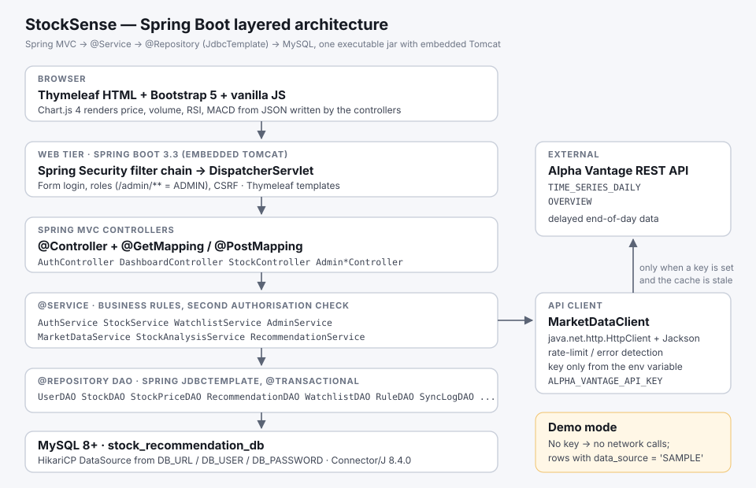
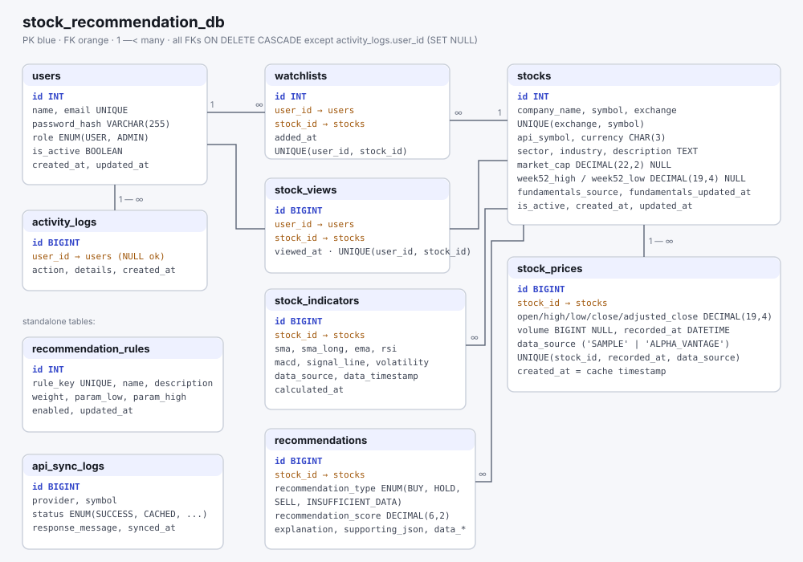

# StockSense — Stocks Recommendations System

A Java web application for exploring stocks, studying their price history and
technical indicators, getting **explainable rule-based BUY / HOLD / SELL
recommendations**, and keeping a private watchlist. Administrators manage
users, stock records, the scoring rules and the market data integration.

**Built with JSF (Jakarta Faces 4.0)** + CDI + plain JDBC + MySQL on Tomcat
10.1 — the same stack and layered architecture as
[NitteSync](https://github.com/vardhan23v/NitteSync). It is a separate,
independently deployable application; NitteSync itself is not modified.

**Live demo:** <https://web-production-4861b6.up.railway.app> (sample data;
demo logins below).

> **Educational and informational purposes only.** Recommendations come from
> fixed technical rules, not personalised financial advice, and they do not
> guarantee any return. Without an API key the app runs on clearly labelled
> **synthetic SAMPLE DATA**, never presented as real prices.



---

## Contents

1. [Features](#features)
2. [Technology stack](#technology-stack)
3. [Where JSF is used](#where-jsf-is-used)
4. [Architecture](#architecture)
5. [Project structure](#project-structure)
6. [Database setup](#database-setup)
7. [Market data provider and API key](#market-data-provider-and-api-key)
8. [Demo mode](#demo-mode)
9. [Build](#build)
10. [Deploy on Tomcat 10.1](#deploy-on-tomcat-101)
11. [Eclipse / IntelliJ setup](#eclipse--intellij-setup)
12. [Demo credentials](#demo-credentials)
13. [Recommendation engine](#recommendation-engine)
14. [Testing](#testing)
15. [Troubleshooting](#troubleshooting)

---

## Features

### Regular user
* Register (PBKDF2-hashed password), log in, log out; session-based login.
* **Dashboard**: welcome, market overview (tracked stocks, latest data date,
  provider status), stock search, 3-month performance chart of the watchlist,
  watchlist preview, top gainers / decliners, latest recommendation cards,
  recently viewed stocks.
* **Stock explorer**: search by ticker or company, filter by exchange and
  sector, sort by ticker, name, price or price movement. Bookmarkable URLs.
* **Stock details**: latest stored close with absolute and % change, source
  and date of the data, volume, range change, 52-week high/low, market cap
  (only when a provider reports it), company info.
  * Interactive charts: close with SMA 20 / SMA 50 / EMA 20 overlays, volume,
    RSI(14) with 30/70 bands, MACD(12,26,9) with signal and histogram.
  * Ranges 1W / 1M / 3M / 6M / 1Y — only offered when the stored history covers
    them. 1D is shown disabled (the provider supplies end-of-day bars only).
  * Indicator cards with plain-language explanations.
  * The rule-based recommendation with every reason and its contribution.
  * Daily OHLCV table for the selected range.
* **Recommendations** page: all stocks, filter by BUY / HOLD / SELL /
  Insufficient, scoring methodology and current rule weights.
* **Watchlist**: add / remove, duplicates prevented (service check + UNIQUE
  constraint), sort by gain / fall / ticker / date added, rising / falling
  counters. Private: the user id always comes from the session.
* **Profile**: account details, change name, change password.

### Administrator
* **Overview**: total users, active stocks, watchlist entries, recommendations,
  latest market data date, API status and calls used today, system activity
  log, recent sync attempts.
* **Users**: activate / deactivate, make admin / user, delete (cannot modify
  your own account).
* **Stocks**: add, edit (symbol, exchange, provider symbol, currency, sector,
  industry, description), activate / deactivate, delete.
* **Rules**: edit weights and thresholds of the scoring engine (validated,
  saved in one transaction, then every stock is re-evaluated); view and delete
  generated recommendations.
* **Market data**: provider configuration (key shown only as
  "configured / not configured"), stored rows per source, per-stock **Sync** /
  **Force** sync, **Sync all stale stocks** on a background thread, and the full
  data update history (`api_sync_logs`).

Every admin action is authorised twice on the server: by `AuthFilter`
(`/admin-*` pages need role ADMIN) and again by `AdminService.requireAdmin()`.

---

## Technology stack

| Layer | Technology |
|---|---|
| Language | Java 21 |
| Web framework | **JSF** — Jakarta Faces 4.0 (Mojarra 4.0.27), Facelets XHTML views |
| Dependency injection | CDI 4.0.1 — Weld Servlet 5.1.7.Final |
| Persistence | Plain JDBC (`PreparedStatement` everywhere), MySQL Connector/J 8.4.0 |
| Database | MySQL 8 or newer (verified on MySQL 26.10) |
| JSON | Gson 2.11.0 (API responses, chart data) |
| HTTP client | `java.net.http.HttpClient` |
| Frontend | XHTML (Facelets), HTML5, CSS3, vanilla JavaScript, Bootstrap 5.3.3, Bootstrap Icons 1.11.3, Chart.js 4.4.1 |
| Server | Apache Tomcat 10.1 (verified on 10.1.61) |
| Build | Maven 3.8+, WAR packaging |
| Tests | JUnit 5 |

No Spring, Hibernate/JPA, React, Angular or Node.js.

---

## Where JSF is used

JSF (JavaServer Faces, now called **Jakarta Faces**) is the web framework of
the whole application. Every page the browser sees is rendered by JSF.

| JSF part | Where in this project |
|---|---|
| Implementation | Mojarra 4.0.27 (`org.glassfish:jakarta.faces` in `pom.xml`), API `jakarta.faces-api` 4.0.1 |
| `FacesServlet` | `WEB-INF/web.xml` maps every `*.xhtml` request to it |
| Facelets views | All 14 pages (`index.xhtml` … `admin-market-data.xhtml`) |
| Page template | `WEB-INF/templates/layout.xhtml` with `ui:insert`; pages use `ui:composition` / `ui:define` |
| Reusable fragments | `WEB-INF/components/*.xhtml` included with `ui:include` + `ui:param` |
| Backing beans | `bean/*Bean.java`: `@Named` CDI beans, `@RequestScoped` or `@ViewScoped` (JSF 4.0 removed `@ManagedBean`) |
| Forms and actions | `h:form`, `h:inputText`, `h:inputSecret`, `h:selectOneMenu`, `h:selectBooleanCheckbox`, `h:commandButton`, `h:commandLink`, action methods with parameters, e.g. `#{watchlistBean.remove(w.stockId)}` |
| Page parameters | `f:viewParam` + `f:viewAction` (e.g. `stock-details.xhtml?stockId=3&range=1Y`) |
| Converters | `f:convertNumber` (prices, %), `f:convertDateTime type="localDateTime"` |
| Iteration | `ui:repeat` for tables, cards and the rules editor (inputs inside `ui:repeat`) |
| Messages | `FacesMessage` via `FacesUtil`, shown by `h:messages`; flash scope keeps them across redirects |
| Navigation | `faces-config.xml` rules (`loginSuccess`, `adminLoginSuccess`, `logout`) plus implicit `?faces-redirect=true` navigation |
| Links | `h:link` with `f:param` and `includeViewParams` |
| Expression Language | `#{...}` in every page, including EL list literals and method calls |

---

## Architecture

```
XHTML page  ->  AuthFilter  ->  FacesServlet  ->  @Named backing bean
            ->  Service (business rules, 2nd authorisation check)
            ->  DAO (SQL)  ->  DBConnection (JDBC)  ->  MySQL

MarketDataService -> MarketDataClient (HttpClient + Gson) -> Alpha Vantage
                  -> StockPriceDAO (cache in MySQL)          (only with an API key)
```

Conventions taken from NitteSync:

* Backing beans are CDI beans: `@Named` with `@RequestScoped` or
  `@ViewScoped` (never `@ManagedBean`). `beans.xml` uses
  `bean-discovery-mode="annotated"`.
* Services and DAOs are plain classes created with `new`; DAOs wrap
  `SQLException` in the unchecked `DataAccessException` whose message can be
  shown to the user.
* `SessionUtil` keeps the logged-in `User` in the HTTP session under one key;
  `FacesUtil` adds messages and keeps them across redirects.
* Pages use `f:viewParam` + `f:viewAction` and `?faces-redirect=true`
  navigation; one Facelets template (`WEB-INF/templates/layout.xhtml`).
* Database settings only in `db.properties`.

Differences from NitteSync (deliberate): passwords use **PBKDF2-SHA256 with a
per-user salt** instead of plain SHA-256, the session id is rotated at login,
and the database / API settings can be overridden with `-D` properties or
environment variables so secrets stay out of the WAR.

Database diagram: [docs/er-diagram.svg](docs/er-diagram.svg)



---

## Project structure

```
pom.xml
README.md
docs/
  architecture.svg               layered architecture
  er-diagram.svg                 database diagram
  recommendation-methodology.md  scoring rules in detail
  TESTING.md                     verification report
tools/
  SampleDataGenerator.java       dev tool that writes sample-data.sql
src/main/java/com/stockrecommendation/
  model/    User, Stock, StockPrice, StockIndicator, Recommendation, Watchlist,
            RecommendationRule, ApiSyncLog, ActivityLog
  dao/      UserDAO, StockDAO, StockPriceDAO, IndicatorDAO, RecommendationDAO,
            WatchlistDAO, RuleDAO, SyncLogDAO, ActivityDAO
  service/  AuthService, StockService, MarketDataService, StockAnalysisService,
            RecommendationService, WatchlistService, AdminService
  bean/     LoginBean, RegisterBean, DashboardBean, StockBean, StockDetailsBean,
            RecommendationBean, WatchlistBean, ProfileBean, MarketStatusBean,
            AdminDashboardBean, AdminUserBean, AdminStockBean,
            AdminRecommendationBean, AdminMarketDataBean
  filter/   AuthFilter
  api/      MarketDataClient, MarketDataResponse, MarketDataException
  util/     DBConnection, AppConfig, PasswordUtil, SessionUtil, FacesUtil,
            JdbcUtil, DataAccessException, AppLifecycleListener, TestConnection
src/main/resources/
  db.properties    database connection
  app.properties   market data provider settings
  schema.sql       tables, keys, indexes (no DROP statements)
  sample-data.sql  demo users, stocks, SAMPLE prices, rules, recommendations
src/main/webapp/
  index, login, register, dashboard, stocks, stock-details, recommendations,
  watchlist, profile, admin-dashboard, admin-users, admin-stocks,
  admin-recommendations, admin-market-data  (.xhtml)
  resources/css/style.css   resources/js/charts.js   resources/img/favicon.svg
  WEB-INF/web.xml  beans.xml  faces-config.xml
  WEB-INF/templates/layout.xhtml
  WEB-INF/components/price-change.xhtml  data-badge.xhtml  rec-badge.xhtml  score-bar.xhtml
src/test/java/com/stockrecommendation/service/
  StockAnalysisServiceTest, RecommendationServiceTest
```

---

## Database setup

Requires MySQL 8 or newer (window functions are used).

```bash
mysql -u root -p < src/main/resources/schema.sql
```

```bash
mysql -u root -p < src/main/resources/sample-data.sql
```

Or open both files in **MySQL Workbench** and run them in that order.

* `schema.sql` creates `stock_recommendation_db` and its 10 tables with
  `CREATE ... IF NOT EXISTS`; it never drops anything.
* `sample-data.sql` is idempotent (`INSERT IGNORE` / `NOT EXISTS` guards) and
  can be run again safely.

Tables: `users`, `stocks`, `stock_prices`, `stock_indicators`,
`recommendations`, `watchlists`, `api_sync_logs`, plus
`recommendation_rules` (engine weights), `stock_views` (recently viewed) and
`activity_logs` (admin activity). Prices use `DECIMAL(19,4)`, never `FLOAT`.
Key constraints: `UNIQUE(exchange, symbol)`, `UNIQUE(stock_id, recorded_at,
data_source)`, `UNIQUE(user_id, stock_id)` on watchlists.

Then set your credentials in `src/main/resources/db.properties`:

```properties
db.url=jdbc:mysql://localhost:3306/stock_recommendation_db?sslMode=DISABLED&allowPublicKeyRetrieval=true
db.user=root
db.password=
```

…or leave the file alone and pass them at runtime: `-Ddb.password=...` or the
environment variable `DB_PASSWORD` (also `DB_URL`, `DB_USER`).

Check the connection:

```bash
mvn compile exec:java -Dexec.mainClass=com.stockrecommendation.util.TestConnection
```

(or run `TestConnection` as a Java application in the IDE). It prints the
MySQL version and row counts.

---

## Market data provider and API key

**Provider: [Alpha Vantage](https://www.alphavantage.co/documentation/)**,
chosen because its free key covers both US listings and Indian listings on BSE
(`RELIANCE.BSE`), which Twelve Data and Finnhub only offer on paid plans.

Free-tier facts the app is built around (verify on alphavantage.co/premium,
limits change):

* about **25 requests per day** and 5 per minute;
* `TIME_SERIES_DAILY` with `outputsize=compact` = the latest **100 daily bars**
  (so with real data the 6M and 1Y ranges are disabled until more history is
  stored);
* delayed **end-of-day** data — the UI never calls it "live";
* `OVERVIEW` (market cap, 52-week range) for US listings.

How the integration behaves (`MarketDataService`):

* **Cache first**: a stock is not downloaded again while its stored provider
  rows are younger than `market.cacheMinutes` (default 720).
* Calls are spaced by `market.minIntervalMs` (13 s) and the app stops at 25
  calls per day (counted from `api_sync_logs`).
* Opening a stock page refreshes it only when stale and never waits for the
  throttle; **Admin > Market data** offers manual and background syncs.
* Downloads are stored in one transaction with
  `INSERT … ON DUPLICATE KEY UPDATE` and `data_source = 'ALPHA_VANTAGE'`.
* Errors are detected and logged, and the cached data is kept:
  `Note` / `Information` bodies → `RATE_LIMITED`; `Error Message` →
  `NO_DATA` (unknown symbol) or `ERROR` (bad key); HTTP errors and timeouts →
  `ERROR`. Provider messages are scrubbed of the API key before logging.
* Provider rows are preferred over SAMPLE rows; the two are never mixed.

### Getting and setting a key

1. Get a free key at <https://www.alphavantage.co/support/#api-key>.
2. Give it to the application **without putting it in source code** — any one
   of these works (first match wins):

   ```bash
   export MARKET_PROVIDER=ALPHA_VANTAGE
   export ALPHA_VANTAGE_API_KEY=your-key-here
   ```

   or JVM options for Tomcat (e.g. in `$CATALINA_BASE/bin/setenv.sh`):

   ```bash
   CATALINA_OPTS="-Dmarket.provider=ALPHA_VANTAGE -Dmarket.apiKey=your-key-here"
   ```

   or, for a local copy that is never committed, `market.provider` /
   `market.apiKey` in `src/main/resources/app.properties`.
3. Restart Tomcat, log in as admin, open **Market data** and click **Sync**
   on a stock (or **Sync all stale stocks**).

Indian symbols use the `.BSE` suffix on Alpha Vantage. Tata Motors was
demerged in 2025 and its listed ticker changed; if `TATAMOTORS.BSE` returns
"NO_DATA", correct the provider symbol in **Admin > Stocks**.

---

## Demo mode

With `market.provider=DEMO` (the default) **or** no API key, the application:

* never sends a network request for market data;
* uses only the rows with `data_source = 'SAMPLE'` from `sample-data.sql`:
  265 trading days per stock (one stock deliberately has 30, to demonstrate
  "Insufficient data"), generated by a seeded random walk in
  `tools/SampleDataGenerator.java`;
* shows an amber **SAMPLE DATA mode** ribbon on every page and a "Sample data"
  badge next to every price, chart and recommendation;
* leaves market cap empty ("Not available") instead of inventing one.

Everything else — charts, indicators, recommendations, watchlists, admin
CRUD — works exactly the same, so the app is fully usable without a key.

To regenerate the sample file (after `mvn compile`):

```bash
java -cp "target/classes:$HOME/.m2/repository/com/google/code/gson/gson/2.11.0/gson-2.11.0.jar" tools/SampleDataGenerator.java > src/main/resources/sample-data.sql
```

---

## Build

Requires JDK 21 and Maven 3.8+.

```bash
mvn clean package
```

This compiles, runs the 13 JUnit tests and produces
`target/stock-recommendation.war`. On macOS with Homebrew, if `java` is not on
the PATH: `export JAVA_HOME=$(brew --prefix openjdk@21)`.

---

## Deploy on Tomcat 10.1

1. Load the database (above) and check `db.properties`.
2. Copy the WAR into Tomcat's `webapps` folder:

   ```bash
   cp target/stock-recommendation.war $CATALINA_HOME/webapps/
   ```

3. Start Tomcat (`$CATALINA_HOME/bin/startup.sh`, or `catalina.sh run` to see
   the log) and open <http://localhost:8080/stock-recommendation/>.

The WAR ships Mojarra, Weld and Connector/J in `WEB-INF/lib`; nothing needs
to be added to Tomcat. Tomcat 10.1 is required (Jakarta EE 10 namespace);
Tomcat 9 will not work.

### Deploy on Railway (Docker)

The repository contains a `Dockerfile` (Maven build + tests, then Tomcat 10.1 /
Java 21, app served at `/`) and `docker/start.sh` (moves Tomcat to Railway's
`$PORT`).

```bash
railway login
railway init --name stock-recommendation
railway add --database mysql
railway add --service web
```

Set the web service variables. They reference the MySQL service, so no
password is copied anywhere:

```bash
railway variable set --service web 'DB_URL=jdbc:mysql://${{MySQL.MYSQLHOST}}:${{MySQL.MYSQLPORT}}/stock_recommendation_db?sslMode=DISABLED&allowPublicKeyRetrieval=true&createDatabaseIfNotExist=true' 'DB_USER=${{MySQL.MYSQLUSER}}' 'DB_PASSWORD=${{MySQL.MYSQLPASSWORD}}' 'DB_INIT=true' 'MARKET_PROVIDER=DEMO'
```

Deploy and get a public URL:

```bash
railway up --service web --detach
```

```bash
railway domain --service web
```

Railway's MySQL is only reachable on its private network, so `DB_INIT=true`
makes the application run `schema.sql` and `sample-data.sql` itself on first
start (`AppLifecycleListener`). It only does so when the `users` table does not
exist yet, so redeploys never touch existing data. To use real prices, also set
`MARKET_PROVIDER=ALPHA_VANTAGE` and `ALPHA_VANTAGE_API_KEY`.

To rename the generated `*.up.railway.app` address: Railway dashboard → the
`web` service → **Settings → Networking** → edit the domain.

---

## Eclipse / IntelliJ setup

**Eclipse (Enterprise Java and Web Developers)**

1. *File > Import > Maven > Existing Maven Projects*, select this folder.
2. *Window > Preferences > Server > Runtime Environments > Add* → Apache Tomcat
   v10.1, point it at your Tomcat folder, JRE = JDK 21.
3. Right-click the project → *Run As > Run on Server* → Tomcat v10.1.
4. If Eclipse shows a facet error, *Properties > Project Facets*: Java 21,
   Dynamic Web Module 6.0, JavaServer Faces 4.0.

**IntelliJ IDEA (Ultimate)**

1. *File > Open* → `pom.xml` → *Open as Project*; Project SDK = 21.
2. *Run > Edit Configurations > + > Tomcat Server > Local*, choose Tomcat 10.1.
3. *Deployment* tab → *+ > Artifact* → `stock-recommendation:war exploded`,
   application context `/stock-recommendation`.
4. Run. (Community edition: build with `mvn package` and copy the WAR.)

---

## Demo credentials

Created by `sample-data.sql`:

| Role | Email | Password |
|---|---|---|
| Administrator | `admin@stocksense.test` | `Admin@123` |
| User | `priya@stocksense.test` | `User@1234` |
| User | `arjun@stocksense.test` | `User@1234` |
| User | `emma@stocksense.test` | `User@1234` |

Each demo user already has a few stocks in their watchlist. Change or remove
these accounts before using the app anywhere but your own machine.

---

## Recommendation engine

Five weighted rules each give +1 / 0 / −1; the score is their weighted sum.

| Rule | Bullish | Bearish | Weight |
|---|---|---|---|
| SMA crossover | SMA20 > SMA50 by > 0.5 % | SMA20 < SMA50 by > 0.5 % | 20 |
| RSI zones | RSI(14) < 30 (oversold) | RSI(14) > 70 (overbought) | 15 |
| MACD | MACD above signal | MACD below signal | 15 |
| Momentum | 20-session change > +3 % | < −3 % | 10 |
| Volume | volume ≥ 1.2 × 20-day avg, with the momentum direction | same, downward | 5 |

**BUY** at score ≥ +25, **SELL** at ≤ −25, otherwise **HOLD**. Fewer than 60
stored bars → **Insufficient data**, never a guess. Every result lists one
reason per rule with its contribution, plus the data date and source.

Weights and thresholds are editable in **Admin > Rules**. Full details:
[docs/recommendation-methodology.md](docs/recommendation-methodology.md).

---

## Testing

* `mvn clean package` runs 13 unit tests: SMA, EMA, RSI (Wilder's reference
  example), MACD, volatility, short-history handling, and the engine's
  BUY / SELL / HOLD / Insufficient / disabled-rule cases.
* The full end-to-end checklist (registration through admin CRUD, API error
  handling against a local stub, demo mode, authorisation, mobile layout) and
  its results are in [docs/TESTING.md](docs/TESTING.md).

---

## Troubleshooting

| Symptom | Fix |
|---|---|
| Every page shows "Could not load …" | MySQL is not running or `db.properties` is wrong. Run `TestConnection`. |
| `Public Key Retrieval is not allowed` | Keep `allowPublicKeyRetrieval=true` in `db.url`. |
| `Unknown database 'stock_recommendation_db'` | Run `schema.sql` first, then `sample-data.sql`. |
| Times are shifted by your UTC offset | Don't add `serverTimezone=UTC` to `db.url` unless MySQL and the JVM both run in UTC. |
| 404 at `/stock-recommendation/` | The WAR did not deploy; check `logs/catalina.out`. Tomcat must be **10.1** with Java 21. |
| `ClassNotFoundException: jakarta.faces…` or CDI errors | Tomcat 9 or an old WAR; use Tomcat 10.1 and redeploy. |
| Charts are empty boxes | The browser could not load Chart.js from jsdelivr (offline). Data tables still show every value. |
| "Demo mode" although a key is set | `market.provider` must also be `ALPHA_VANTAGE` (or `MARKET_PROVIDER`). Restart Tomcat after changing. |
| Sync says `RATE_LIMITED` | Free tier used up (25/day or 5/min). Cached data stays; try again tomorrow. |
| Sync says `NO_DATA` for an Indian stock | Check the provider symbol (`SYMBOL.BSE`) in Admin > Stocks. |
| `View expired` after leaving a page open | The session timed out (30 min); you are sent to the login page. |
| `java: command not found` / wrong Java | `export JAVA_HOME=$(brew --prefix openjdk@21)` (macOS) or install JDK 21. |
